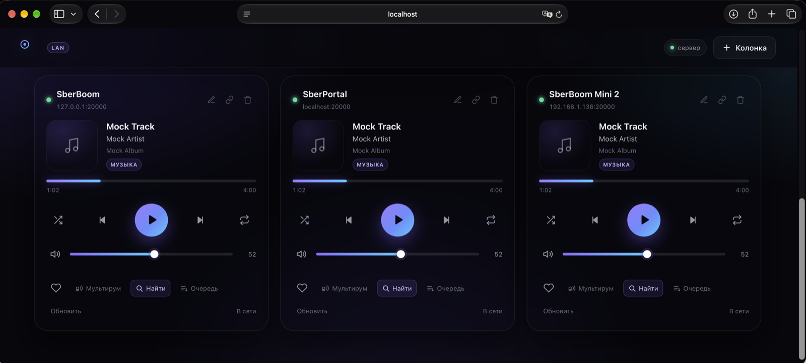

# SberBoom Standalone


Локальное управление колонками SberBoom из браузера — **без Home Assistant**, без облака и без аккаунта Sber. Один процесс Node.js, веб-интерфейс доступен с любого устройства в вашей сети.



```
┌──────────────┐   HTTP/SSE   ┌──────────────┐   WSS :20000   ┌────────────┐
│ браузер/тел. │ ───────────► │ Node.js :8080│ ─────────────► │ SberBoom 1 │
└──────────────┘              │              │ ─────────────► │ SberBoom 2 │
                              │              │ ─────────────► │ SberBoom 3 │
                              └──────────────┘                └────────────┘
```

## Возможности

- Несколько колонок одновременно (карточка на каждую) + общая панель «Все колонки»
- **Поиск и отправка из Звука**: кнопка **«Найти»** прямо на карточке колонки открывает поиск по названию — или вставку ссылки `zvuk.com` / числового ID — и запускает выбранное только на этой колонке
- **История поиска**: найденное и запущенное сохраняется, часто используемое предлагается первым
- **Очередь колонки**: что играет и что дальше (до 20 треков) с названиями из каталога
- **Мультирум**: нативный SberCast-мультирум одной кнопкой — прошивка локально собирает группу по `START_MULTIROOM`; программная deeplink-синхронизация осталась только в API
- Play / Pause / Next / Prev, seek по прогресс-бару
- Громкость и mute (в том числе для всех колонок сразу)
- Shuffle, repeat (off → all → one), лайк
- Обложка, название, исполнитель, альбом, позиция и длительность
- Живые обновления по push от колонки (смена трека — мгновенно)
- Сопряжение нажатием `+` на корпусе, токен сохраняется между запусками
- **Bluetooth**: режим сопряжения колонки, список спаренных устройств, подключение / отключение / забывание, скан устройств рядом с RSSI
- Автопереподключение с backoff, keep-alive, детект half-open TCP
- Поиск колонок через mDNS и добавление по IP вручную
- Полностью локально: наружу уходят только запросы к каталогу/обложкам Звука, без аккаунта и облака Сбера

## Требования

- Node.js 20+ (проверено на 26)
- Колонка и компьютер в одной сети; порт `20000` доступен

## Запуск

```bash
git clone https://github.com/sergvax/sboom_node.git
cd sboom_node
npm install
npm start
```

Откройте `http://<ip-компьютера>:8080` — адрес печатается в консоли при старте.

Порт можно поменять: `PORT=3000 npm start`.

### Первое подключение

1. Нажмите **«+ Колонка»**, введите IP колонки (или найдите через **«Искать»**).
2. На карточке нажмите **«Сопрячь»**.
3. В течение 2 минут нажмите и удерживайте **«+» на корпусе колонки** (там, где показывается громкость).
4. Готово — токен сохранится в `data/speakers.json`, повторять не нужно.

Повторите для каждой из трёх колонок. Имена можно менять (карандаш на карточке).

## Поиск и отправка из Звука

Нажмите **«Найти»** на карточке нужной колонки. Поиск откроется в контексте именно этой колонки: её имя есть в заголовке и в подсказке, а все результаты запускаются только на ней — выбрать «не ту» колонку нельзя.

1. Введите название трека, плейлиста, исполнителя или альбома — приложение покажет результаты по разделам, клик по строке (или по кнопке «Играть») запускает контент;
2. если поиск не работает, раскройте **«Поиск не работает? Вставьте ссылку или ID Звука»** и вставьте `https://zvuk.com/track/123`, `/playlist/123`, `/artist/123`, `/album/123` (то же, что `/release/123`) либо просто числовой ID.

После успешного запуска окно поиска закрывается и возвращает к карточке колонки — она подсвечивается. Крестик в поисковой строке тоже закрывает поиск и возвращает к карточке; повторное открытие с пустым запросом показывает историю.

**История поиска.** Сохраняется только то, что вы сами нашли и запустили из этого окна: при следующем открытии показываются **«Часто запускаете»** (2+ запуска) и **«Недавние»**. Очередь, прямые ссылки и автозапуски в историю не попадают. История лежит в `data/search-history.json` (права `600`), общая для всех браузеров, и очищается кнопкой «Очистить».

Колонка запускает контент из своей сессии Звука через deeplink `staros://music`:

| Контент | Deeplink |
| --- | --- |
| Трек | `staros://music?tid=<id>&pt=track` |
| Подкаст / эпизод | `staros://music?tid=<id>&pt=podcast` |
| Плейлист | `staros://music?pid=<id>&pt=playlist` |
| Исполнитель | `staros://music?pid=<id>&pt=artist` |
| Альбом | `staros://music?pid=<id>&pt=release` |

Все пять типов проверены на реальных колонках; альбом, исполнитель и плейлист подтверждаются по `playlistId`/`playlistTitle`/`playlistType` в `GET_STATE`.

**Если поиск недоступен**, приложение не теряет функциональность: вставьте ссылку или ID в разделе «Поиск не работает?» — deeplink собирается без каталога. Названия и обложки в этом случае могут не отобразиться, а очередь покажет только ID треков. Поиск идёт параллельно двумя каналами (REST `/api/tiny/search` и GraphQL `/api/v1/graphql`), поэтому сбой одного из них не ломает выдачу. Анонимный токен и cookie Звука кэшируются в `data/zvuk-session.json` (права `600`) и переиспользуются между запусками.

**Очередь** (кнопка на карточке) читается командой `op=17` и содержит только ID треков (до 20, без названий) — названия подтягиваются из каталога. Для радио, Bluetooth и «волны» прошивка очередь не отдаёт.

Ограничения отправки:

- запуск **заменяет** текущий контекст воспроизведения; команды «добавить в конец очереди» в протоколе нет;
- числовой ID без типа может совпасть у разных сущностей (трек и плейлист) — в этом случае приложение попросит вставить полную ссылку, чтобы не запустить не то;
- на ведомую колонку мультирума отправлять контент нельзя — отправляйте на источник, группа подхватит тот же deeplink.

## Bluetooth

Кнопка **«Bluetooth»** на карточке открывает панель встроенного Bluetooth-модуля колонки. Отдельный Bluetooth-адаптер на компьютере не нужен: команды идут по тому же локальному WebSocket-протоколу, что и управление музыкой.

- **«Режим сопряжения»** (`op=22`) — колонка становится видимой как A2DP-приёмник. Откройте Bluetooth на телефоне или компьютере, найдите колонку и подключитесь к ней; звук пойдёт с вашего устройства на колонку. Длительность окна видимости задаёт прошивка.
- **Спаренные устройства** (`op=19`) — имя, MAC и статус подключения. Кнопки позволяют подключить, отключить или забыть устройство (`op=20`: connect / disconnect / remove).
- **Рядом** (`op=21`) — скан видимых Bluetooth-устройств с уровнем сигнала (RSSI). Список справочный: подключать нужно уже спаренные устройства из верхнего списка.

Текущий трек, играющий по Bluetooth, показывается на карточке с источником `Bluetooth`: название и исполнитель приходят из `GET_STATE`, обложки у такого трека нет. Мультирум и перенос воспроизведения на другие колонки для Bluetooth не работают — это отдельный физический источник, а не контекст Звука.

## Мультирум

Включите трек или волну Звука на одной колонке и нажмите **«Мультирум»** на её карточке (или кнопку с иконкой трансляции в панели «Все колонки»). Запустится **нативный SberCast-мультирум**: прошивка сама соберёт группу из колонок в локальной сети по `MediaCommand START_MULTIROOM` (op=16, cmd=8), без облака и общего Сбер ID. Проверено на SberBoom, SberPortal и SberBoom Mini 2 (прошивка 1.104.35).

- Перед запуском на мастере должен играть трек или волна Звука: без активного источника прошивка отвечает `PRS_NOT_SUPPORTED_BY_AUDIO_SOURCE` и группу не создаёт. Поэтому кнопка на «пустой» карточке неактивна — включите звук на ней или на другой колонке.
- Мастер получает `multiroom.mode = MASTER` за десятки миллисекунд, ведомые — `SLAVE` примерно за секунду. На карточках появляются чипы «нативный мастер» / «нативный мультирум».
- Синхронизацией звука управляет сама прошивка (PTP/audio pipeline), а не приложение: нет deeplink-перезапусков и целосекундного `seek`, поэтому рассинхрона «на ухо» нет.
- Пауза и play на мастере применяются ко всей группе; next/prev/seek тоже уходят в firmware-группу.
- Громкость у каждой колонки своя — `SetVolume` на мастере ведомых не меняет. Общий ползунок «Все колонки» меняет громкость каждой колонки отдельно.
- Пауза на мастере распускает группу автоматически примерно через 10 секунд (`turnOffMultiroomAfterPauseMs`). Кнопка **«Стоп»** ставит мастер на паузу и ждёт возврата всех колонок в `NONE`.
- Если нативная группа не поднялась (другая модель/прошивка, источник без поддержки), интерфейс покажет ошибку — тихого переключения на программный режим нет.

### Программная синхронизация (только API)

В интерфейсе её больше нет — именно она давала слышимый рассинхрон и
«замирание» ведомой до паузы на источнике. Код и эндпоинты сохранены для
совместимости и как аварийный фолбэк:

- `POST /api/multiroom/start` `{sourceId}` — ведомые запускают тот же трек
  через `DEEPLINK` и выравниваются по секунде источника;
- `POST /api/multiroom/stop`, `POST /api/multiroom/leave` `{id}`.

Ограничения этого режима: только треки Звука с `trackId` (радио и Bluetooth
не переносятся), совпадение на старте в пределах ~1 c, в установившемся
режиме рассинхрон ~0.2–0.5 c. Одновременно с нативным мультирумом он не
включается.

## Демо без колонок

Встроенная мок-колонка:

```bash
npm run mock     # wss://127.0.0.1:20000
npm start        # в другом терминале
```

Добавьте `127.0.0.1` и нажмите «Сопрячь» — «+» жать не нужно.

## Тесты

```bash
npm test
```

Покрыто: TLV-кодек, парсеры track/state/queue, нормализация адреса, полный e2e-цикл
`pair → reconnect → state/metadata → команды → push → сохранение токена` на мок-колонке,
а также e2e мультирума (старт со средней секунды источника, синхронная пауза, next через deeplink, стоп),
запуск контента и очередь с метаданными каталога, клиент Звука (REST+GraphQL, сессия, 401,
недоступность каталога, неоднозначный ID), история поиска (дедупликация, счётчики, права 600,
очистка), Bluetooth (op=19…22: парсинг списков, скан с RSSI, режим сопряжения,
connect/disconnect/remove) и UI-сценарии «карточка → поиск → запуск/история → возврат к карточке»
и «карточка → Bluetooth → скан/сопряжение/команды».

## Данные и приватность

- `data/speakers.json` — IP, имена и **pin-токены** колонок. Файл создаётся автоматически с правами 600; не публикуйте его.
- `data/zvuk-session.json` — анонимный токен и cookie каталога Звука (права 600). Это не аккаунт Сбера: токен выдаётся анонимно и нужен только для поиска и метаданных.
- `data/search-history.json` — личная история запусков из поиска (права 600): названия, обложки, счётчики. Общая для всех браузеров; очищается из окна поиска.
- Сервер слушает `0.0.0.0:8080` **без пароля**. Это осознанно: приложение рассчитано на доверенную домашнюю сеть. Если сеть не доверенная — поставьте `HOST=127.0.0.1` и/или заверните в reverse-proxy с авторизацией.
- Наружу уходят HTTPS-запросы к `zvuk.com` (поиск, метаданные, обложки) и `cdn-image.zvuk.com`. Управление колонкой — исключительно LAN.

## Как это работает

Протокол повторяет логику [sboom_ha](https://github.com/dzerik/sboom_ha); Bluetooth-опкоды взяты из [TohaRG2/sboom_ha](https://github.com/TohaRG2/sboom_ha):

- `wss://<ip>:20000/` с самоподписанным сертификатом (проверка сертификата отключена).
- Бинарный TLV (protobuf-подобный): `varint` + length-delimited + float32.
- Pair: запрос `op=4`, пользователь нажимает `+`, колонка отдаёт pin-токен; далее токен идёт в поле 3 каждого запроса.
- Состояние: `op=12` (громкость/mute/подсистемы), метаданные: `op=10`.
- Однократный `op=10` подписывает соединение на push-обновления трека.
- Команды: `op=14` громкость, `op=15` seek, `op=16` медиа-команды, `op=18` keep-alive.
- Bluetooth: `op=19` список спаренных, `op=20` команда устройству (connect/disconnect/remove),
  `op=21` скан видимых устройств, `op=22` режим сопряжения.
- Громкость пушится не всегда, поэтому раз в 10 секунд идёт лёгкий поллинг `op=12`;
  метаданные — раз в 15 секунд как страховка, основной канал — push.

## Автозапуск на macOS (launchd)

`~/Library/LaunchAgents/local.sboom.plist`:

```xml
<?xml version="1.0" encoding="UTF-8"?>
<!DOCTYPE plist PUBLIC "-//Apple//DTD PLIST 1.0//EN" "http://www.apple.com/DTDs/PropertyList-1.0.dtd">
<plist version="1.0">
<dict>
  <key>Label</key><string>local.sboom</string>
  <key>ProgramArguments</key>
  <array>
    <string>/opt/homebrew/bin/node</string>
    <string>/Users/ВАШ_ПУТЬ/sboom/server.js</string>
  </array>
  <key>WorkingDirectory</key><string>/Users/ВАШ_ПУТЬ/sboom</string>
  <key>RunAtLoad</key><true/>
  <key>KeepAlive</key><true/>
  <key>StandardOutPath</key><string>/tmp/sboom.log</string>
  <key>StandardErrorPath</key><string>/tmp/sboom.err.log</string>
</dict>
</plist>
```

```bash
launchctl load ~/Library/LaunchAgents/local.sboom.plist
```

## Если что-то не работает

| Симптом | Что проверить |
| --- | --- |
| «Колонка не ответила» | Верный ли IP, включена ли колонка, открыт ли порт: `nc -zv <ip> 20000` |
| «Порт 20000 закрыт» | Другой IP после перезагрузки роутера — поправьте адрес (удалить/добавить) |
| Не находится через «Искать» | Роутер режет multicast (AP isolation) — добавьте по IP вручную |
| Сопряжение зависает | Нажимайте именно `+` на корпусе, окно — 2 минуты |
| Токен перестал работать после сброса колонки | На карточке «Сопрячь заново» (иконка звена) |
| Нет обложек | Обложки берутся с CDN Звука; без интернета будет градиент-заглушка |

## Ограничения текущей версии

- Поиск и каталог используют недокументированный публичный API веб-плеера Звука. Он может измениться без предупреждения; ссылки и числовые ID при этом продолжат работать.
- Очередь отдаёт только ID треков и не поддерживает «добавить в очередь»: запуск контента заменяет текущий контекст.
- Мультирум — нативный SberCast: требует активного источника на мастере и поддержки прошивками колонок. Программная deeplink-синхронизация доступна только через API и может давать рассинхрон до ~0.5 c.
- Тексты песен и будильники не включены. Bluetooth-панель управляет встроенным модулем колонки; отдельного BT-адаптера на сервере нет.
- Скан Bluetooth (`op=21`) может занимать несколько секунд и зависит от прошивки; список «Рядом» не гарантирует, что устройство можно подключить без предварительного спаривания.
- Громкость, изменённая голосом или кнопками колонки, доезжает до UI с задержкой до 10 секунд (поллинг).
- Если прошивка изменит протокол, адаптер может перестать работать — как и любая локальная интеграция.

## Структура

```
sboom_node/
├── server.js            HTTP API + SSE + статика
├── lib/
│   ├── tlv.js           бинарный TLV-кодек
│   ├── protocol.js      опкоды и константы
│   ├── parsers.js       разбор track/state/queue/BT
│   ├── speaker.js       WS-клиент колонки + pair + Bluetooth
│   ├── manager.js       supervisor на колонку, optimistic-команды
│   ├── zvuk.js          каталог Звука: поиск, метаданные, deeplink
│   ├── history.js       история запусков из поиска
│   ├── discovery.js     mDNS _staros._tcp
│   └── store.js         JSON-хранилище
├── public/              веб-интерфейс (без сборки)
├── docs/screenshot.png  скриншот интерфейса для README
├── mock/speaker.js      мок-колонка для демо и тестов
├── test/                node:test
├── CHANGELOG.md         история версий
└── .github/workflows/   CI (npm test)
```

## Лицензия

MIT. Проект не аффилирован со Сбером; работает только с колонками, которыми вы владеете, и требует физического нажатия `+` для авторизации.
